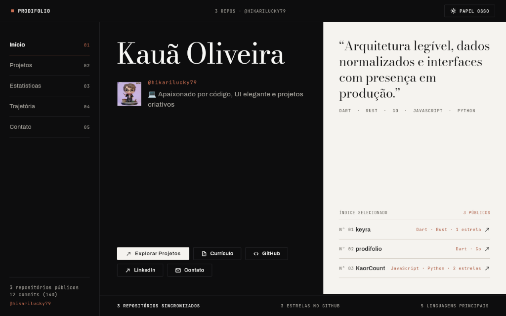
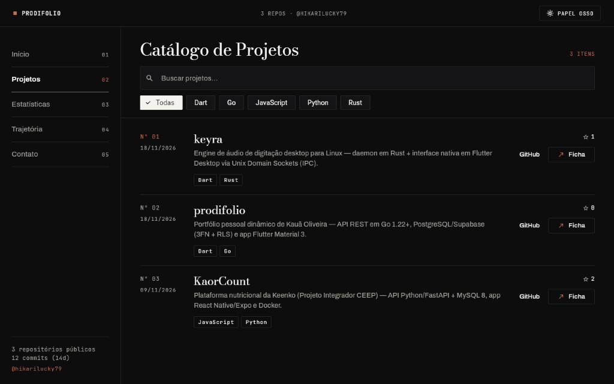

<div align="center">

# Prodifolio

[](https://github.com/hikarilucky79/prodifolio/actions/workflows/ci.yml)


[](https://dev-hikari.vercel.app)

[Portfólio ao vivo](https://dev-hikari.vercel.app) · [Currículo (PDF)](https://dev-hikari.vercel.app/curriculo.pdf) · [API Health](https://prodifolio-api.vercel.app/health) · [LinkedIn](https://www.linkedin.com/in/kau%C3%A3-oliveira-43b07b268/)

</div>

---

## O que é

**Prodifolio** é o portfólio profissional dinâmico de **Kauã Oliveira** (`@hikarilucky79`): uma API REST em **Go 1.22+** sincroniza automaticamente os repositórios e estatísticas do GitHub, persiste snapshots e mensagens de contato no **TiDB Cloud (PostgreSQL em 3FN)** e alimenta um aplicativo multiplataforma em **Flutter Material 3** (Web e Mobile) publicado em produção na Vercel.

---

## Prévia da Interface

| Tela inicial (`https://dev-hikari.vercel.app`) | Catálogo de Projetos sincronizado |
|---|---|
|  |  |

---

## Principais Funcionalidades

- **Sincronização dinâmica com o GitHub:** coleta perfil, repositórios públicos e distribuição real de bytes por linguagem, filtrando o repositório de perfil (`hikarilucky79`), destacando multi-linguagens (`>= 15%` dos bytes) e resolvendo descrições legadas ou ausentes.
- **Catálogo pesquisável e ficha técnica:** busca textual instantânea, filtros por linguagem (`Dart`, `Go`, `JavaScript`, `Python`, `Rust`) e cartão de detalhes para cada projeto.
- **Estatísticas e trajetória:** cálculo de uso das linguagens com gráfico nativo desenhado em `CustomPainter`, além de linha do tempo com a arquitetura do projeto e a formação técnica no CEEP Curitiba (2024–2026).
- **Contato persistido e protegido:** formulário com validação de campos, rate limiting por IP e gravação normalizada em tabelas separadas no TiDB Cloud.
- **Tema editorial escuro/claro e currículo integrado:** alternância instantânea entre tema escuro e *Papel Osso* em Material 3 e acesso direto ao currículo ATS em PDF (`/curriculo.pdf`).

---

## Arquitetura e Tecnologias

```text
Flutter (Web & Mobile · Riverpod · CustomPainter)
        │
        ▼  HTTPS / JSON (CORS estrito em produção)
Backend API em Go 1.22+ (net/http · slog · cache TTL · singleflight · rate limit)
        ├── GitHub REST API (sincronização + proteção contra cota)
        └── TiDB Cloud PostgreSQL 3FN (snapshots de projetos, rate limit e contato)
```

| Camada | Tecnologias | Responsabilidade |
|---|---|---|
| **Frontend** | Flutter, Dart, Riverpod, `CustomPainter`, Material 3 | Interface responsiva (Web + Android), cache local de estado e tema escuro/claro |
| **Backend** | Go 1.22+ (`net/http`, `slog`), `singleflight`, TTL Cache | Orquestração GitHub + TiDB Cloud, validação, rate limit por IP e cabeçalhos de segurança |
| **Banco de Dados** | TiDB Cloud (PostgreSQL), SQL em 3FN | Persistência normalizada de perfil, repositórios, linguagens, rate limit e contatos |
| **Infraestrutura** | Vercel, Dockerfile multi-stage, GitHub Actions | Hospedagem serverless (frontend + API), CSP estrito com CanvasKit local e CI contínuo |

### Estrutura do monorepo

```text
prodifolio/
├── .github/workflows/ci.yml
├── docs/screenshots/          # Capturas reais em produção
├── db/migrations/001_tidb_init.sql
├── backend/
│   ├── cmd/server/main.go
│   ├── internal/
│   │   ├── cache/          # Cache em memória com TTL e relógio injetável
│   │   ├── config/         # Configuração por variáveis de ambiente
│   │   ├── github/         # Cliente da API REST do GitHub (interface injetável)
│   │   ├── httpapi/        # Rotas Go 1.22 net/http, CORS, slog e erros JSON
│   │   ├── portfolio/      # Regras de projetos, estatísticas e validação de contato
│   │   ├── ratelimit/      # Rate limit por IP com suporte opcional a proxy confiável
│   │   └── store/          # Persistência TiDB/Postgres 3FN + fallback em memória
│   ├── Dockerfile
│   ├── .env.example
│   └── go.mod
├── app/
│   ├── lib/
│   │   ├── core/           # Config via --dart-define e tema Material 3 claro/escuro
│   │   ├── data/           # Cliente HTTP e implementação do repositório
│   │   ├── domain/         # Entidades e contrato PortfolioRepository
│   │   └── presentation/   # Providers Riverpod, telas, widgets e CustomPainter
│   ├── test/
│   └── pubspec.yaml
└── README.md
```

**Justificativa do Riverpod:** Riverpod garante injeção de dependências com segurança em tempo de compilação e override direto do repositório nos testes sem `BuildContext`, evitando boilerplate de eventos/estados do Bloc para uma UI orientada a chamadas assíncronas.

### Banco de dados (TiDB Cloud · 3FN)

O arquivo [db/migrations/001_tidb_init.sql](./db/migrations/001_tidb_init.sql) cria as tabelas normalizadas até a **Terceira Forma Normal (3FN)**:

- **1FN:** Todos os campos são atômicos; grupos repetidos de linguagens por repositório são separados em `repository_languages`.
- **2FN:** Na única tabela com chave composta (`repository_languages(repository_id, language_id)`), `bytes_count` depende da chave inteira.
- **3FN:** Nenhuma dependência transitiva nem totais derivados armazenados:
  - `owners` isola dados do perfil GitHub de `repositories`.
  - `languages` isola nomes de linguagens das tabelas de repositórios.
  - `contact_senders` separa identidade (`email`, `name`) de `contact_messages` (cada envio aponta para `sender_id`).

#### Aplicando a migração no TiDB Cloud

1. Crie um cluster PostgreSQL-compatible no [TiDB Cloud](https://tidbcloud.com).
2. No **SQL Editor** do TiDB Cloud (ou via `psql`), execute o conteúdo de `db/migrations/001_tidb_init.sql`.
3. Copie a connection string PostgreSQL com `?sslmode=require` e configure `TIDB_DB_URL`.

---

## Boas Práticas de Engenharia

- **Testes automatizados em Go e Flutter:**
  - **Backend (6 suítes de testes em Go):** [`cache_test.go`](./backend/internal/cache/cache_test.go), [`config_test.go`](./backend/internal/config/config_test.go), [`handler_test.go`](./backend/internal/httpapi/handler_test.go), [`service_test.go`](./backend/internal/portfolio/service_test.go), [`limiter_test.go`](./backend/internal/ratelimit/limiter_test.go) e [`supabase_rest_test.go`](./backend/internal/store/supabase_rest_test.go), executadas com detector de race (`go vet ./... && go test -race -v ./...`).
  - **App Flutter:** [`portfolio_repository_test.dart`](./app/test/portfolio_repository_test.dart) e [`widget_test.dart`](./app/test/widget_test.dart) executados junto à análise estática (`flutter analyze && flutter test`).
- **CI contínuo no GitHub Actions:** [`.github/workflows/ci.yml`](./.github/workflows/ci.yml) valida os jobs `Backend (Go)` e `App (Flutter)` a cada push e pull request para `main`.
- **Variáveis de ambiente e segurança:** template versionado em [`backend/.env.example`](./backend/.env.example) (nenhum segredo commitado), configuração em tempo de build no app via `--dart-define`, cabeçalhos CSP/CORS estritos em [`app/vercel.json`](./app/vercel.json) (CanvasKit self-hosted via `canvasKitBaseUrl: 'canvaskit/'`) e **Row Level Security (RLS)** ativo por padrão no banco.
- **Containers, Clean Architecture e versionamento:** [`backend/Dockerfile`](./backend/Dockerfile) multi-stage, separação em camadas (`core`, `data`, `domain`, `presentation` no Flutter e `internal/*` no Go) e histórico mantido com commits semânticos (`feat:`, `fix:`, `docs:`).

---

## Rodando localmente

### 1. Backend (Go 1.22+)

```bash
cd backend
cp .env.example .env
# Preencha GITHUB_TOKEN (recomendado para evitar 60 req/h) e TIDB_DB_URL (opcional em dev)
go run ./cmd/server
```

Variáveis de ambiente principais:

| Variável | Padrão | Descrição |
|---|---|---|
| `PORT` | `8080` | Porta HTTP do servidor |
| `GITHUB_USERNAME` | `hikarilucky79` | Usuário GitHub do portfólio |
| `GITHUB_TOKEN` | _(vazio)_ | Personal Access Token (nunca no código) |
| `CACHE_TTL` | `15m` | Expiração do cache em memória |
| `CORS_ALLOWED_ORIGINS` | `*` | Origens permitidas separadas por vírgula |
| `CONTACT_RATE_LIMIT` | `5` | Máximo de envios no `POST /contact` por janela |
| `CONTACT_RATE_WINDOW` | `1m` | Janela do rate limit por IP |
| `TRUST_PROXY` | `false` | Se `true`, lê `X-Forwarded-For` / `X-Real-IP` |
| `TIDB_DB_URL` | _(vazio)_ | Connection string PostgreSQL do TiDB Cloud (vazio usa memória em dev; aceita `DATABASE_URL` como fallback) |

Testes do backend:

```bash
cd backend
go vet ./...
go test -race -v ./...
```

### 2. App Flutter (Web e Mobile)

A URL da API nunca fica fixa no código; informe via `--dart-define`:

```bash
cd app
flutter pub get

# Web
flutter run -d chrome --dart-define=API_BASE_URL=http://localhost:8080

# Android Emulator (aponta localhost da máquina via 10.0.2.2)
flutter run --dart-define=API_BASE_URL=http://10.0.2.2:8080
```

Opcionalmente, passe `--dart-define=RESUME_URL=https://seu-link-de-curriculo.pdf` para abrir um PDF externo no botão **Currículo** (sem ela, o app exibe um resumo interativo do perfil).

Testes e análise do app:

```bash
cd app
flutter analyze
flutter test
```

---

## Deploy

### Banco de Dados (TiDB Cloud)

Provisione o banco PostgreSQL-compatible no TiDB Cloud e execute [db/migrations/001_tidb_init.sql](./db/migrations/001_tidb_init.sql).

Configure a string de conexão na variável `TIDB_DB_URL` (com `?sslmode=require`) do backend.

### Backend na Vercel (`backend/vercel.json`)

```bash
cd backend
vercel login
vercel --scope hikari-s-projects2 link --yes
vercel --scope hikari-s-projects2 env add TIDB_DB_URL production
vercel --scope hikari-s-projects2 env add GITHUB_TOKEN production
vercel --scope hikari-s-projects2 env add TRUST_PROXY production
vercel --scope hikari-s-projects2 env add CORS_ALLOWED_ORIGINS production
vercel --scope hikari-s-projects2 deploy --prod
```

> Em ambiente serverless na Vercel, o cache em memoria e o rate limit por IP valem por instancia quente, enquanto o TiDB Cloud persiste snapshots, rate limit e contatos entre invocacoes.

### Backend via Docker (Fly.io, Cloud Run, Render, Railway)

```bash
cd backend
docker build -t prodifolio-api .
docker run -p 8080:8080 \
  -e GITHUB_TOKEN="$GITHUB_TOKEN" \
  -e TIDB_DB_URL="$TIDB_DB_URL" \
  -e CORS_ALLOWED_ORIGINS="https://seu-dominio.com" \
  -e TRUST_PROXY=true \
  prodifolio-api
```

### App Flutter Web na Vercel (`app/vercel.json`)

```bash
cd app
flutter build web --release \
  --dart-define=API_BASE_URL=https://sua-api.vercel.app \
  --dart-define=RESUME_URL=https://dev-hikari.vercel.app/curriculo.pdf
cp vercel.json build/web/vercel.json
cd build/web
vercel --scope hikari-s-projects2 deploy --prod
```

Para Cloudflare Pages ou Netlify, publique diretamente a pasta `app/build/web`.
